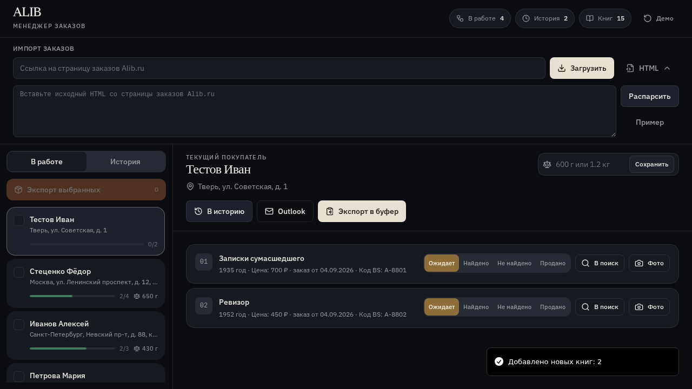
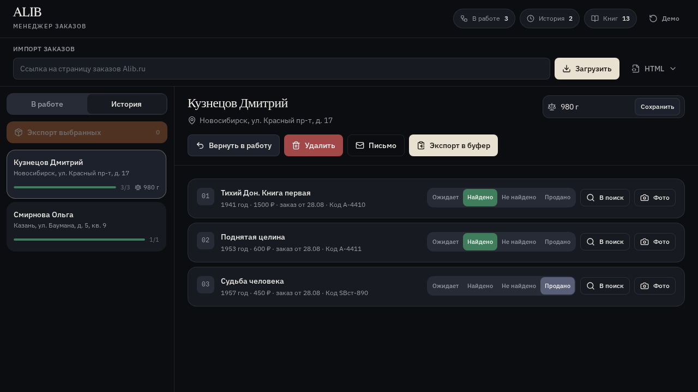

# ALIB — менеджер заказов

Внутренний инструмент букинистического магазина: собирает заказы с **Alib.ru**,
раскладывает их по покупателям и помогает довести каждую книгу до ответа
клиенту.



## Что умеет

- **Импорт заказов** — по ссылке на страницу заказов Alib.ru или вставкой
  готового HTML.
- **Покупатели** — адрес, сумма, список книг, прогресс «найдено / всего».
- **Книги** — год, цена, номер заказа и статусы: ожидает, найдено, не найдено,
  продано.
- **Поиск и фото** — быстрый переход к поиску книги и карточке товара.
- **Экспорт** — выбранные заказы в HTML, буфер обмена и Outlook.
- **История** — завершённые заказы, возврат в работу, удаление.
- **Демо-режим** — посмотреть интерфейс без реальных данных.



## Стек

React 19 · TanStack Start / Router / Query · Vite · Tailwind CSS 4 · Radix UI ·
zustand · zod · PGlite / PostgreSQL · Better Auth · TypeScript.

## Запуск

Нужен Node.js 22. Проект собран в Grok App Builder, поэтому окружение
подхватывается через `scripts/with-app-env.mjs`.

```bash
npm install
npm run dev
```

Приложение слушает `0.0.0.0:8080`. Проверки:

```bash
npm run typecheck
npm run build
npm test
```

## Статус

Рабочий прототип: импорт, карточки покупателей, статусы и экспорт уже собраны.
Дальше — аккуратнее с реальными заказами и автоматизацией ответов.
